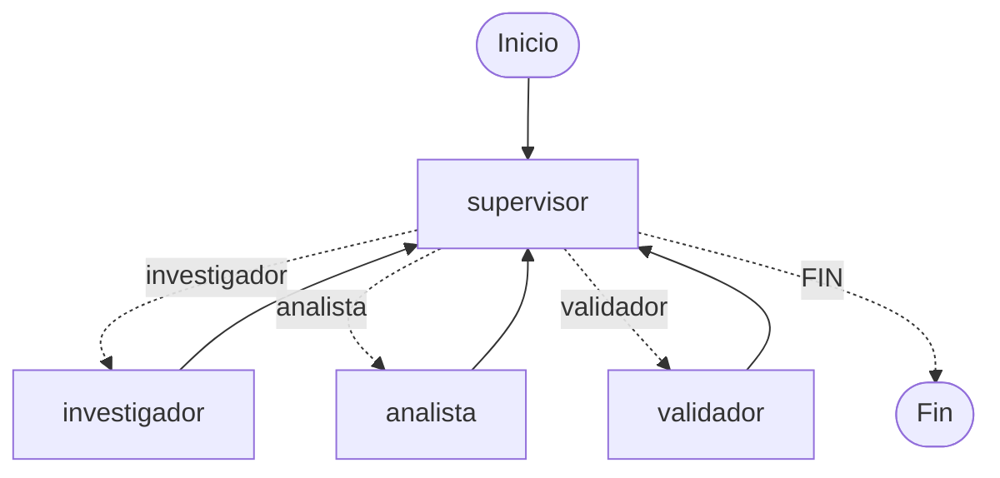

# Pre-entrega 6 — Orquestador Multi-Agente Especializado

Prototipo de un orquestador multi-agente jerarquico construido con LangGraph, compuesto por un nodo Supervisor, dos agentes especialistas con herramientas funcionales (Investigador y Analista) y un nodo de Validacion de calidad antes del cierre.

## Requisitos

- Python 3.12 o superior
- Clave de API de Google Gemini, OpenAI o Anthropic

## Instalacion

1. Crear y activar entorno virtual:
```bash
python -m venv .venv
# En Windows:
.venv\Scripts\Activate.ps1
# En Linux / Mac:
# source .venv/bin/activate
```

2. Instalar dependencias:
```bash
pip install -r requirements.txt
```

3. Configurar variables de entorno:
Crear archivo `.env` a partir de `.env.example`:
```env
LLM_PROVIDER=gemini
GEMINI_API_KEY=tu_clave_de_gemini
# O para OpenAI:
# LLM_PROVIDER=openai
# OPENAI_API_KEY=tu_clave_de_openai
```

## Topologia y Flujo del Grafo

Se selecciono una **topologia jerarquica centralizada (Supervisor-Worker con Validacion)**:



### Por que se eligio esta topologia
1. **Separacion clara de responsabilidades:** En lugar de saturar un solo agente con multiples herramientas disimiles, cada agente opera dentro de su dominio acotado (obtencion de datos tecnicos vs computo matematico).
2. **Control determinista y sin ciclos infinitos:** El Supervisor evalua en cada turno el estado compartido y decide la siguiente intervencion mediante un tipo `Literal`, complementado con un contador de pasos (`recursion_limit: 15`).
3. **Manejo de conflictos:** Al no comunicarse los especialistas entre si de forma horizontal, se eliminan los desacuerdos o colisiones de datos. El Supervisor actua como unico arbitro y juez de completitud.
4. **Prevencion de contaminacion de contexto:** Cada especialista recibe solo la instruccion especifica y los datos necesarios para su tarea, manteniendo el contexto limpio y compatible con todos los proveedores.

## Especialistas y Herramientas

- **Supervisor (`supervisor.py`):** Evalua el estado del flujo y rutea dinamicamente hacia los especialistas o hacia la sintesis final (`FIN`).
- **Investigador (`agents/research_agent.py`):** Consulta servidores de infraestructura y especificaciones tecnicas mediante la herramienta `buscar_servidores_infraestructura`.
- **Analista (`agents/analyst_agent.py`):** Realiza calculos matematicos de costos mensuales, costos anuales y proyeccion de ahorro mediante la herramienta `calcular_proyeccion_costos`.
- **Validador (`validator.py`):** Verifica que se cuente con los datos tecnicos y los computos requeridos antes de permitir la finalizacion.

## Ejecucion

Ejecutar el orquestador principal:
```bash
python main.py
```

La ejecucion guarda el historial detallado de cada paso en `traza_ejecucion.json`.

## Ejemplo de salida en consola

```text
Consulta del usuario:
Necesito analizar la infraestructura de servidores cloud de ana.gomez@hotmail.com, calcular su costo mensual total y determinar cuanto ahorraria anualmente si le aplicamos un 15% de descuento por contrato anual.

Iniciando orquestacion multi-agente...

[Paso 1] Nodo activo: supervisor
  Mensaje: [Supervisor]: Delegando siguiente tarea al agente 'investigador'. Motivo: Aun no se han buscado los servidores o infraestructura del cliente.

[Paso 2] Nodo activo: investigador
  Mensaje: [Investigador]: El cliente Ana Gomez tiene activos los servidores Base de datos PostgreSQL Principal con identificador srv-prod-db y Cluster Redis Cache con identificador srv-cache-redis.

[Paso 3] Nodo activo: supervisor
  Mensaje: [Supervisor]: Delegando siguiente tarea al agente 'analista'. Motivo: Ya se realizo la investigacion de la infraestructura y ahora se deben calcular los costos y ahorros correspondientes.

[Paso 4] Nodo activo: analista
  Mensaje: [Analista]: Computo finalizado. El costo mensual final es de 330.48 dolares, el costo anual final es de 3965.76 dolares y se proyecta un ahorro anual de 699.84 dolares gracias a la aplicacion del 15 por ciento de descuento.

[Paso 5] Nodo activo: supervisor
  Mensaje: [Supervisor]: Delegando siguiente tarea al agente 'validador'. Motivo: Ya se completaron la investigacion y el calculo de costos, pero aun falta auditar y validar dichos resultados.

[Paso 6] Nodo activo: validador
  Mensaje: [Validador]: Control de calidad finalizado. Aprobado: True. Todos los requerimientos fueron cubiertos con datos reales y calculos precisos.

[Paso 7] Nodo activo: supervisor
  Mensaje: Informe tecnico y financiero para Ana Gomez (ana.gomez@hotmail.com), con plan Enterprise Cloud. Infraestructura activa: Base de datos PostgreSQL Principal (db.m5.xlarge), Cluster Redis Cache (cache.r5.large). El costo operativo base es de USD 388.8 mensuales, lo que equivale a USD 4665.6 al ano. Al aplicar un descuento del 15.0% por compromiso anual, el ahorro total es de USD 699.84 al ano, dejando un costo anual final de USD 3965.76.

Respuesta final del Orquestador:
Informe tecnico y financiero para Ana Gomez (ana.gomez@hotmail.com), con plan Enterprise Cloud. Infraestructura activa: Base de datos PostgreSQL Principal (db.m5.xlarge), Cluster Redis Cache (cache.r5.large). El costo operativo base es de USD 388.8 mensuales, lo que equivale a USD 4665.6 al ano. Al aplicar un descuento del 15.0% por compromiso anual, el ahorro total es de USD 699.84 al ano, dejando un costo anual final de USD 3965.76.

Flujo completado exitosamente.
```
